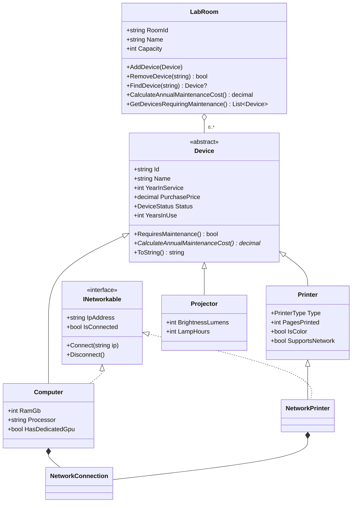

# BÁO CÁO THỰC HÀNH – HỆ THỐNG QUẢN LÝ THIẾT BỊ VÀ HỢP ĐỒNG BẢO TRÌ

- **Mã sinh viên:** 202418906
- **Họ tên:** Lê Gia Huân
- **Link GitHub (mã nguồn):** https://github.com/<tai-khoan>/LabW05a  *(điền sau khi đẩy lên)*
- **Ngôn ngữ / nền tảng:** C# – .NET 8 (Console App)

---

## 1. Phân tích yêu cầu nghiệp vụ

| Yêu cầu | Cách đáp ứng |
|---|---|
| Quản lý 3 loại thiết bị có thông tin chung, chi phí bảo trì khác nhau | Lớp trừu tượng `Device` + 3 lớp dẫn xuất `Computer`, `Printer`, `Projector` |
| Mã thiết bị không rỗng, chỉ gán khi khởi tạo | `Id` chỉ có `get`, kiểm tra trong constructor |
| Giá mua > 0, năm sử dụng ≤ năm hiện tại | Kiểm tra trong setter, ném `ArgumentException` |
| Máy tính luôn kết nối mạng, chỉ một số máy in có mạng, máy chiếu không | Interface `INetworkable`; `Computer` và `NetworkPrinter` thực thi |
| Phòng chứa nhiều thiết bị; thiết bị tồn tại khi chưa có phòng | `LabRoom` kết tập `List<Device>` |
| Không trùng mã, không nhận null | Kiểm tra trong `LabRoom.AddDevice` |
| Tính tổng chi phí không dùng if/switch theo loại | `LabRoom` gọi `CalculateAnnualMaintenanceCost()` đa hình |
| Thiết bị cần bảo trì: `UnderMaintenance` hoặc đã dùng trên 5 năm | `Device.RequiresMaintenance()` |

**Công thức chi phí bảo trì/năm**

- Máy tính: 5% giá mua; +2% nếu có GPU rời; +1% nếu đã dùng trên 5 năm.
- Máy in: 4% giá mua; +500.000 đ nếu đã in trên 100.000 trang; +300.000 đ nếu là máy in màu.
- Máy chiếu: 3% giá mua; +1.500.000 đ nếu bóng đèn đã dùng trên 3.000 giờ.

**Thuộc tính bổ sung và lý do**

- `Printer.IsColor`: công thức có điều kiện "máy in màu", nhưng loại máy in (laser/phun) không cho biết máy in màu hay đơn sắc, vì vậy cần thêm thuộc tính này.
- `Device.YearsInUse` (thuộc tính tính toán): dùng chung cho công thức của máy tính và điều kiện "trên 5 năm".
- `Device.DeviceType`: tên loại thiết bị để hiển thị, mỗi lớp con tự cung cấp, nhờ đó không cần kiểm tra kiểu khi in ra.
- `NetworkConnection`: thành phần chứa logic kết nối/ngắt kết nối, dùng chung cho `Computer` và `NetworkPrinter` để không lặp mã.

## 2. Danh sách lớp và sơ đồ quan hệ

| Lớp / kiểu | Loại | Vai trò |
|---|---|---|
| `DeviceStatus` | enum | Active, UnderMaintenance, Retired |
| `PrinterType` | enum | Laser, Inkjet |
| `Device` | abstract class | Thông tin chung, kiểm tra dữ liệu, phương thức trừu tượng tính chi phí |
| `Computer` | class : Device, INetworkable | Máy tính |
| `Printer` | class : Device | Máy in không có mạng |
| `NetworkPrinter` | class : Printer, INetworkable | Máy in có mạng |
| `Projector` | class : Device | Máy chiếu |
| `INetworkable` | interface | Khả năng kết nối mạng |
| `NetworkConnection` | class | Thành phần xử lý trạng thái kết nối |
| `LabRoom` | class | Phòng thực hành, kết tập Device |

**Giải thích quan hệ**

- **Kế thừa** (`Computer`, `Printer`, `Projector` → `Device`): quan hệ "là một". Máy tính *là một* thiết bị, nên dùng chung toàn bộ thông tin và quy tắc kiểm tra của thiết bị.
- **Thực thi interface** (`Computer`, `NetworkPrinter` → `INetworkable`): quan hệ "có khả năng". Kết nối mạng là năng lực, không phải bản chất của mọi thiết bị.
- **Kết tập** (`LabRoom` o– `Device`): phòng chỉ giữ tham chiếu tới thiết bị. Thiết bị được tạo bên ngoài phòng và tồn tại độc lập với phòng.

## 3. Phương án cho "chỉ một số máy in có khả năng mạng"

**Phương án chọn:** tách lớp `NetworkPrinter` kế thừa `Printer` và thực thi `INetworkable`.

**Trade-off:** Phương án này cho phép kiểm tra khả năng mạng ngay khi biên dịch. Chỉ đối tượng `NetworkPrinter` mới có `Connect()`, và có thể duyệt chung qua kiểu `INetworkable` cùng với `Computer`. Nhược điểm là khả năng mạng được cố định khi tạo đối tượng: muốn nâng cấp một máy in thường thành máy in mạng thì phải tạo đối tượng mới. Nếu sau này có thêm nhiều năng lực khác (scan, fax…), số lớp con có thể tăng theo tổ hợp. Phương án dùng thành phần mạng riêng kết tập vào thiết bị thì linh hoạt hơn khi chạy, nhưng mọi máy in đều phải kiểm tra "có thành phần mạng hay không" lúc chạy chương trình. Với phạm vi hiện tại chỉ có một năng lực là mạng, kế thừa đơn giản và rõ ràng hơn. Để không lặp mã, logic kết nối được đặt trong lớp `NetworkConnection` dùng chung.

## 4. Kết quả chạy

*(Chèn ảnh chụp màn hình khi chạy `dotnet run` trong VS Code)*

Kết quả chính (năm hiện tại 2026):

| Phòng | Thiết bị | Chi phí bảo trì/năm |
|---|---|---|
| P305 | PC01 (GPU rời, 2 năm): 32.000.000 × 7% | 2.240.000 |
| P305 | PC02 (không GPU, 8 năm): 12.000.000 × 6% | 720.000 |
| P305 | PR01 (laser, đơn sắc, 8.000 trang): 3.000.000 × 4% | 120.000 |
| **P305** | **Tổng** | **3.080.000** |
| P112 | PR02 (máy in mạng, màu, 150.000 trang): 240.000 + 500.000 + 300.000 | 1.040.000 |
| P112 | PJ01 (4.200 giờ bóng đèn): 420.000 + 1.500.000 | 1.920.000 |
| **P112** | **Tổng** | **2.960.000** |

- Thêm trùng mã PC01 → bị từ chối: "Phòng P305 đã có thiết bị mã 'PC01'."
- Thiết bị cần bảo trì: PC02 (đã dùng 8 năm), PJ01 (đang bảo trì, đã dùng 7 năm).
- Kết nối mạng: PC01, PC02, PR02 (duyệt qua `INetworkable`). Kết nối lại khi đang kết nối và IP rỗng đều bị từ chối. Sau khi ngắt kết nối thì `IsConnected = False` và `IP = ''`.
- Gỡ PR01 khỏi P305 thì đối tượng PR01 vẫn tồn tại và được chuyển sang P112, minh họa kết tập.

## 5. Vì sao Device là lớp trừu tượng?

- "Thiết bị" là một khái niệm chung. Trong thực tế chỉ có máy tính, máy in hay máy chiếu cụ thể, nên tạo một đối tượng `Device` chung chung là vô nghĩa.
- Mọi thiết bị đều có chi phí bảo trì, nhưng **không có công thức chung**. Vì vậy `CalculateAnnualMaintenanceCost()` là phương thức trừu tượng, buộc mỗi lớp con phải cài đặt.
- Lớp trừu tượng vẫn chứa được **dữ liệu và mã dùng chung**: các trường, quy tắc kiểm tra mã/giá/năm, `ToString()`, `RequiresMaintenance()`. Interface không làm được việc này, vì interface không giữ trạng thái và không ràng buộc constructor.
- `Device` là kiểu cơ sở để `LabRoom` quản lý chung mọi loại thiết bị.

## 6. Vì sao INetworkable là interface?

- Kết nối mạng là một **năng lực**, không gắn chặt với loại thiết bị. Máy tính luôn có mạng, chỉ một số máy in có mạng, còn máy chiếu thì không. Nếu đặt năng lực này vào `Device` thì máy chiếu sẽ thừa hưởng một năng lực mà nó không có.
- C# chỉ cho kế thừa đơn từ một lớp. `NetworkPrinter` đã kế thừa `Printer`, nhưng vẫn có thể thực thi thêm `INetworkable`.
- Interface cho phép các lớp không cùng nhánh (`Computer` và `NetworkPrinter`) được xử lý chung qua một kiểu, ví dụ `allDevices.OfType<INetworkable>()`.
- Sau này, khi máy chiếu hoặc thiết bị mới cần mạng, chỉ cần thực thi interface mà không phải sửa cây kế thừa.

## 7. Tính đa hình được thể hiện ở đâu?

1. **`LabRoom.CalculateAnnualMaintenanceCost()`**: `_devices.Sum(d => d.CalculateAnnualMaintenanceCost())`. Biến `d` có kiểu `Device`, nhưng lúc chạy chương trình sẽ gọi đúng công thức của `Computer`, `Printer` hoặc `Projector`, không dùng if/switch.
2. **`ToString()`**: được ghi đè ở từng lớp. Khi in danh sách, câu lệnh `Console.WriteLine(device)` tự hiển thị thông tin riêng của từng loại.
3. **`DeviceType` và `SupportsNetwork`**: thuộc tính abstract/virtual được ghi đè. `NetworkPrinter` ghi đè `SupportsNetwork = true`.
4. **Đa hình qua interface**: vòng lặp `foreach (INetworkable net in networkDevices)` gọi `Connect()`/`Disconnect()` mà không cần biết đối tượng là `Computer` hay `NetworkPrinter`.

## 8. LabRoom – Device: kết tập hay hợp thành?

Đây là quan hệ **kết tập**. Thiết bị được tạo bên ngoài phòng, trong `Program`, và tồn tại trong hệ thống ngay cả khi chưa được phân bổ vào phòng nào. Khi gỡ thiết bị khỏi phòng (`RemoveDevice`) hoặc khi hủy phòng, đối tượng thiết bị không bị hủy và có thể chuyển sang phòng khác (chương trình minh họa điều này với PR01). Vòng đời của Device không phụ thuộc vào LabRoom, vì vậy đây không phải quan hệ hợp thành.

## 9. Quy trình sử dụng AI

*(Bổ sung bằng chứng: commit tự làm trước, ảnh chụp/log phiên làm việc với AI, các điểm đã thảo luận, đánh giá, tự phản biện và kết luận.)*
